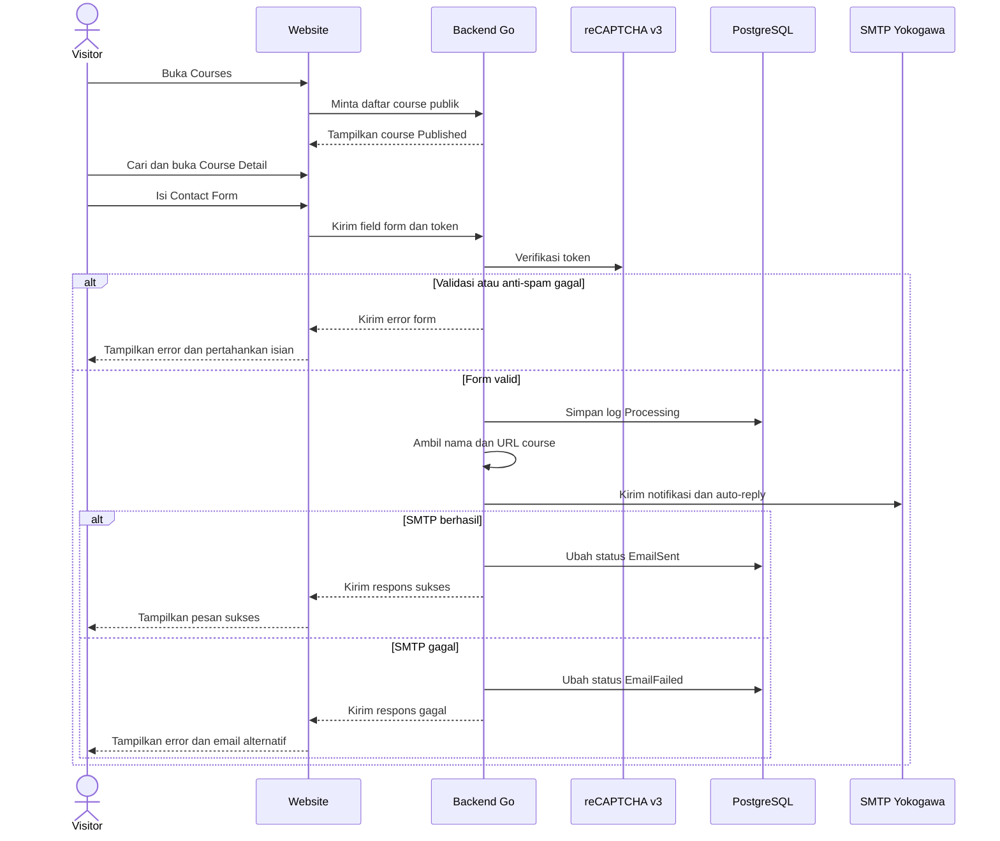
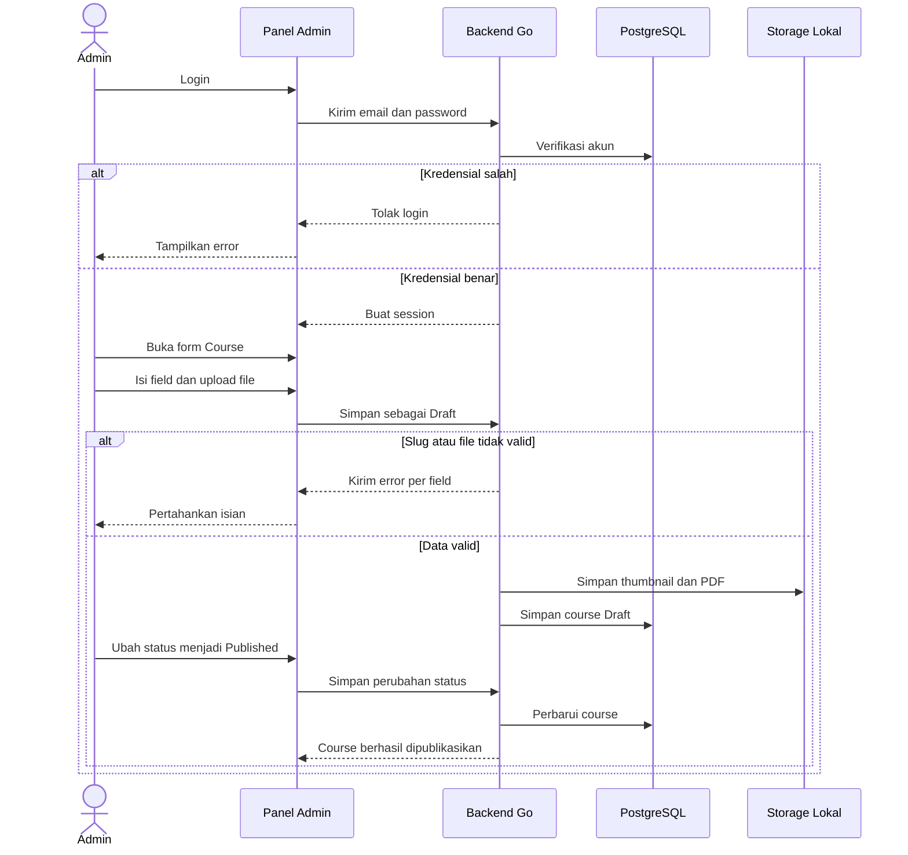
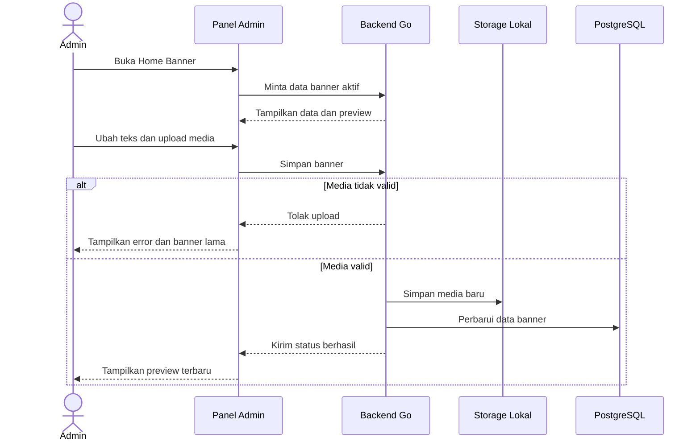
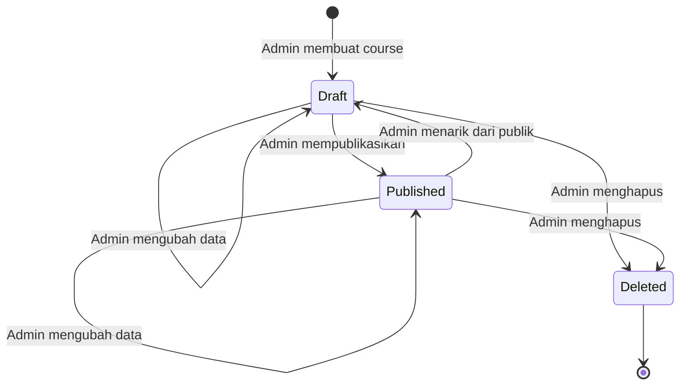
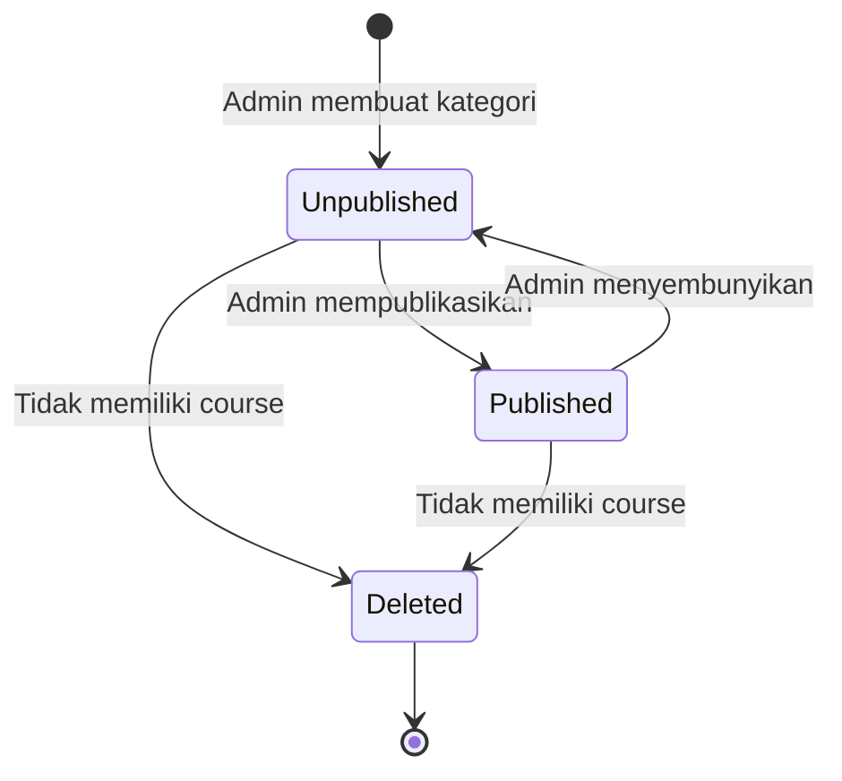
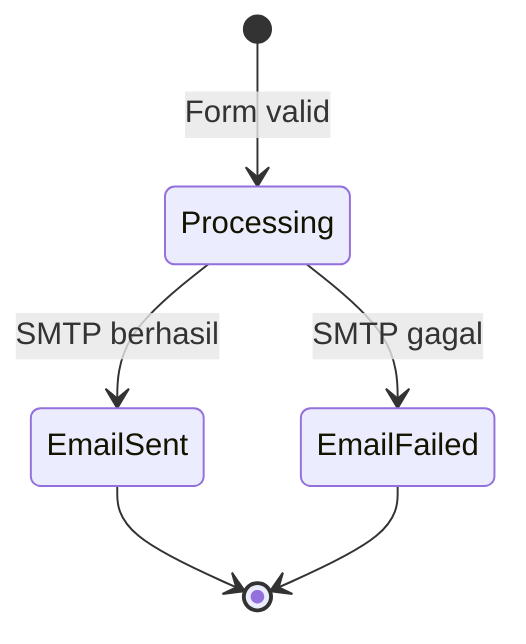

# Product Requirements Document — Yokogawa Indonesia Website

## 1. Personas

### Visitor — Partner atau Customer

- **Role:** Engineer, operator, procurement, atau calon peserta yang mencari informasi training tanpa login.
- **Goals:**
  - Menemukan course berdasarkan nama atau kategori.
  - Membaca detail, biaya, dan jadwal PDF.
  - Mengirim pertanyaan kepada Yokogawa.
- **Frustrations:**
  - Informasi training masih tergabung dalam website grup.
  - Informasi course dan jadwal sulit ditemukan.
  - Tidak mengetahui apakah pertanyaan berhasil dikirim.
- **Modules touched:**
  - M02 Halaman Publik & Navigasi — Primary
  - M03 Course — Primary
  - M04 SEO & GEO — Secondary
  - M09 Contact Form, SMTP & Log — Primary

### Admin — Staf Yokogawa

- **Role:** Staf Yokogawa dengan satu role Admin; akun dibuat developer.
- **Goals:**
  - Mengelola kategori dan course.
  - Mempublikasikan course yang siap ditampilkan.
  - Memperbarui Home banner tanpa bantuan developer.
- **Frustrations:**
  - Perubahan konten sebelumnya bergantung pada website grup atau developer.
  - Course yang belum lengkap berisiko tampil ke publik.
  - Upload media yang tidak valid dapat merusak tampilan.
- **Modules touched:**
  - M03 Course — Primary
  - M05 Autentikasi Admin — Primary
  - M06 Kategori Course — Primary
  - M07 Home Banner — Primary
  - M10 Infrastruktur, QA & Security Scan — Secondary

### Sistem

- **Role:** Backend yang merender halaman, mengelola data, memvalidasi form, mengirim email, dan mencatat status pengiriman.
- **Goals:**
  - Menampilkan hanya course dan kategori yang boleh dipublikasikan.
  - Mengirim Contact Form dengan konteks yang benar.
  - Menyimpan metadata log tanpa menyimpan isi pesan.
- **Frustrations:**
  - SMTP atau koneksi database dapat gagal.
  - File upload dapat memiliki tipe atau ukuran tidak valid.
  - Konteks course dari browser dapat dimanipulasi.
- **Modules touched:**
  - M02 Halaman Publik & Navigasi — Primary
  - M03 Course — Primary
  - M04 SEO & GEO — Primary
  - M05 Autentikasi Admin — Primary
  - M06 Kategori Course — Primary
  - M07 Home Banner — Primary
  - M08 Backend & Database — Primary
  - M09 Contact Form, SMTP & Log — Primary
  - M10 Infrastruktur, QA & Security Scan — Primary
  - M11 Konten Awal & Handover — Secondary

## 2. Persona Journey Diagrams

### CUJ-1 — Visitor bertanya tentang course

### CUJ-2 — Admin menambah dan mempublikasikan course

### CUJ-3 — Admin memperbarui Home banner

## 3. Entity State Diagrams

### Course

### Kategori Course

### Contact Form Log

## 4. User Stories (Persona-First)

### FR01 [WEB] Desain UI/UX

- UI Design - Halaman publik (Home, Courses, Course Detail, FAQ, Contact Us, 404)
- UI Design - Layar admin (login, kategori, course, Home banner, ganti password)
- Desain - Revisi desain (maksimal 3 revisi mayor, revisi minor kosmetik)

### FR02 [WEB] Halaman Publik & Navigasi

- Layout & Navigasi - Header dan footer (menu mobile, informasi kontak)
- Home page (hero dinamis, About, Why Join, kategori training, CTA Contact)
- FAQ page (banner, accordion keyboard-accessible, CTA Contact)
- Contact Us page (informasi kontak, Google Maps, Contact Form)
- 404 page (pesan, tombol Home dan Courses)
- Responsive States - UX states (loading, empty, error, viewport 360–1920px)

### FR03 [WEB] Course

- Courses page (filter kategori, search 300 ms, Course Card, empty state)
- Course Detail page (informasi course, PDF, Contact Form, related courses)
- ⚠ Performa Course - Respons search dan filter (≤300 ms untuk ≤100 course)

### FR03 [ADMIN] Course

- CRUD Course (informasi course, biaya, PDF, metadata SEO, status)
- Course List page (search nama, filter kategori/status, konfirmasi hapus)
- ⚠ Upload Course - Validasi file (thumbnail ≤2MB, PDF ≤10MB, MIME)

### FR04 [WEB] SEO & GEO

- SEO - Meta tag (title, description, canonical, Open Graph)
- SEO - File crawler (sitemap.xml, robots.txt)
- GEO - Structured data (Organization, Course, FAQPage, BreadcrumbList, llms.txt)
- ⚠ Performa SEO - Target mobile (SEO ≥90, Accessibility ≥85, LCP ≤2,5 detik)

### FR05 [ADMIN] Autentikasi Admin

- Admin Login page (email, password, error state)
- Admin - Ganti password dan logout

### FR06 [ADMIN] Kategori Course

- CRUD Kategori Course (nama, short description, Published/Unpublished)
- Kategori Course - Proteksi penghapusan (masih memiliki course)

### FR07 [ADMIN] Home Banner

- Home Banner edit page (media, judul, deskripsi, tombol, URL, preview)
- ⚠ Upload Banner - Validasi media (MP4 ≤20MB, gambar ≤2MB)

### FR09 [WEB] Contact Form, SMTP & Log

- Contact Form component (nama, email, telepon, perusahaan, pesan)
- Contact Form Course - Informasi course (nama dan URL dari server)
- Contact Form States - Respons submit (loading, sukses, error, input dipertahankan)

### FR10 [WEB] Infrastruktur, QA & Security Scan

- QA WEB - Uji website publik (fungsi, responsive, aksesibilitas, browser)

### FR10 [ADMIN] Infrastruktur, QA & Security Scan

- QA ADMIN - Uji panel admin (login, session, CRUD, upload, Home banner)

## 5. Acceptance Criteria

### FR01 Desain UI/UX

- **Given** brand guideline Yokogawa tersedia  
  **When** Figma diserahkan  
  **Then** tersedia desain 6 halaman publik dan layar admin pada 360px dan 1440px.
- **Given** tiga revisi mayor sudah digunakan  
  **When** perubahan layout mayor berikutnya diminta  
  **Then** permintaan dicatat sebagai change request.

### FR02 Halaman Publik & Navigasi

- **Given** visitor membuka website pada viewport 360px  
  **When** menu mobile dibuka  
  **Then** Home, Courses, FAQ, dan Contact Us dapat dipilih menggunakan keyboard.
- **Given** visitor membuka URL yang tidak tersedia  
  **When** server merespons halaman  
  **Then** halaman 404 tampil dengan tombol menuju Home dan Courses.

### FR03 Course

- **Given** course Published berada dalam kategori Published  
  **When** visitor membuka Courses atau mencari namanya  
  **Then** course tampil pada hasil dalam ≤300 ms waktu respons server untuk katalog ≤100 course.
- **Given** course masih Draft atau kategorinya Unpublished  
  **When** visitor membuka katalog atau URL course  
  **Then** course tidak tampil dan URL detail memberikan halaman 404.
- **Given** Admin mengupload thumbnail di atas 2MB atau PDF di atas 10MB  
  **When** form Course disimpan  
  **Then** file ditolak, error tampil pada field, dan input lain tetap tersedia.
- **Given** slug sudah digunakan course lain  
  **When** Admin menyimpan course  
  **Then** penyimpanan ditolak dengan error slug unik.
- **Given** course tidak memiliki PDF  
  **When** Course Detail dibuka  
  **Then** tombol Download Training Schedule tidak tampil.

### FR04 SEO & GEO

- **Given** course berubah menjadi Published  
  **When** `sitemap.xml` dan `llms.txt` dibuka  
  **Then** URL course tercantum beserta canonical yang benar.
- **Given** halaman Home dan Course Detail diuji pada mobile  
  **When** Lighthouse dijalankan pada build staging final  
  **Then** SEO ≥90, Accessibility ≥85, dan LCP ≤2,5 detik.
- **Given** course kembali menjadi Draft  
  **When** file crawler dibuat  
  **Then** URL course tidak tercantum pada `sitemap.xml` atau `llms.txt`.

### FR05 Autentikasi Admin

- **Given** kredensial Admin benar  
  **When** Admin login  
  **Then** session PostgreSQL dibuat dan panel admin terbuka.
- **Given** password salah  
  **When** Admin login  
  **Then** akses ditolak, pesan error tampil, dan session tidak dibuat.
- **Given** session tidak aktif selama 2 jam  
  **When** Admin mengakses route terlindungi  
  **Then** session berakhir dan Admin dialihkan ke login.
- **Given** password lama salah atau password baru kurang dari 8 karakter  
  **When** Admin mengganti password  
  **Then** perubahan ditolak dan password lama tetap berlaku.

### FR06 Kategori Course

- **Given** kategori valid disimpan sebagai Published  
  **When** Courses dibuka  
  **Then** kategori tersedia sebagai filter.
- **Given** kategori masih memiliki minimal satu course  
  **When** Admin menghapus kategori  
  **Then** penghapusan ditolak dan kategori tetap tersimpan.
- **Given** kategori diubah menjadi Unpublished  
  **When** visitor membuka katalog  
  **Then** kategori dan seluruh course di dalamnya tidak tampil.

### FR07 Home Banner

- **Given** Admin menyimpan gambar valid maksimal 2MB atau MP4 maksimal 20MB  
  **When** Home dibuka  
  **Then** media, judul, deskripsi, dan tombol terbaru tampil.
- **Given** media melampaui batas atau MIME tidak sesuai  
  **When** banner disimpan  
  **Then** upload ditolak dan banner lama tetap aktif.
- **Given** URL tombol tidak valid  
  **When** form banner disimpan  
  **Then** perubahan ditolak dengan error pada field URL.

### FR08 Backend & Database

- **Given** input mengandung tag `<script>`  
  **When** data dirender  
  **Then** `html/template` meng-escape tag dan script tidak dijalankan.
- **Given** request perubahan data tidak membawa token CSRF valid  
  **When** backend menerima request  
  **Then** request ditolak dan database tidak berubah.
- **Given** transaksi database gagal di tengah penyimpanan  
  **When** operasi berakhir  
  **Then** transaksi di-rollback dan tidak ada record setengah tersimpan.

### FR09 Contact Form, SMTP & Log

- **Given** Contact Form valid dikirim dari Course Detail  
  **When** backend memproses form  
  **Then** log `Processing` dibuat, email berisi nama dan URL course dari server, lalu status menjadi `EmailSent`.
- **Given** SMTP gagal  
  **When** pengiriman diproses  
  **Then** status menjadi `EmailFailed`, visitor melihat error dan email alternatif, serta input tetap tersedia.
- **Given** skor reCAPTCHA di bawah 0,5  
  **When** form dikirim  
  **Then** submit ditolak dan Contact Form Log tidak dibuat.
- **Given** satu IP telah mengirim 5 form dalam 1 menit  
  **When** submit keenam dilakukan  
  **Then** submit ditolak dengan pesan untuk mencoba kembali.
- **Given** form valid diproses  
  **When** database diperiksa  
  **Then** hanya email, nama course, URL course, waktu kirim, dan status yang tersimpan.
- **Given** submit berasal dari Contact Us  
  **When** log dibuat  
  **Then** nama dan URL course dikosongkan.

### FR10 Infrastruktur, QA & Security Scan

- **Given** aplikasi crash  
  **When** systemd mendeteksi service berhenti  
  **Then** aplikasi aktif kembali dalam ≤10 detik.
- **Given** backup harian telah berjalan selama 8 hari  
  **When** daftar backup diperiksa  
  **Then** hanya 7 backup terakhir tersedia.
- **Given** OWASP ZAP atau SonarQube menemukan temuan High/Critical  
  **When** proyek akan diluncurkan  
  **Then** temuan diperbaiki dan di-retest hingga jumlah terbuka menjadi 0.
- **Given** website dan panel admin masuk tahap UAT  
  **When** QA dijalankan  
  **Then** fungsi utama lulus pada dua versi terakhir Chrome, Edge, Safari, dan Firefox.

### Spesifikasi Laporan

| Laporan | Kolom | Rumus | Filter | Urut/Grup | Export |
|---|---|---|---|---|---|
| Laporan Security Scan | Tool, tanggal scan, ID temuan, kategori, severity, URL/file terdampak, deskripsi, status perbaikan, tanggal retest, hasil retest | Jumlah per severity = jumlah temuan pada setiap severity per tool; temuan terbuka = jumlah temuan High/Critical yang belum lolos retest; target sebelum launch = 0 | Tool, severity, status perbaikan | Critical, High, Medium, Low; grup per tool | PDF [ASUMSI — Cokin mengonfirmasi kepada Novian sebelum launch] |

### FR11 Konten Awal & Handover

- **Given** Yokogawa menyerahkan materi maksimal 7 kategori dan 30 course  
  **When** input awal selesai  
  **Then** seluruh data, thumbnail, dan PDF tersedia di panel admin.
- **Given** handover dilakukan  
  **When** artifact diperiksa  
  **Then** source code, Figma, dokumentasi, serta panduan admin tersedia.
- **Given** bug sesuai scope ditemukan dalam satu bulan setelah launch  
  **When** bug dilaporkan  
  **Then** Timedoor memperbaikinya dalam masa garansi.

## 6. Edge Cases & Unhappy Paths

### Persona: Visitor

- **FR02 Halaman Publik & Navigasi** — Google Maps gagal dimuat.  
  Expected: alamat dan informasi kontak statis tetap tampil.
- **FR03 Course** — Search tidak menemukan course.  
  Expected: empty state dan tombol reset filter tampil.
- **FR03 Course** — PDF hilang dari storage meski path masih tersimpan.  
  Expected: tombol PDF disembunyikan dan error teknis dicatat.
- **FR04 SEO & GEO** — Meta description course kosong.  
  Expected: short description digunakan sebagai fallback.
- **FR09 Contact Form, SMTP & Log** — Token reCAPTCHA kedaluwarsa.  
  Expected: submit ditolak tanpa membuat log dan visitor diminta mencoba kembali.
- **FR09 Contact Form, SMTP & Log** — Visitor mengirim ulang setelah SMTP gagal.  
  Expected: log baru dibuat; log gagal sebelumnya tetap tersimpan.
- **FR09 Contact Form, SMTP & Log** — Konteks course dari browser dimanipulasi.  
  Expected: backend mengabaikan nilai browser dan memakai nama serta URL dari record server.
- **FR10 Infrastruktur, QA & Security Scan** — Website dibuka pada browser di luar dua versi terakhir.  
  Expected: dukungan tidak dijamin; browser yang tercakup tetap berfungsi sesuai acceptance criteria.

### Persona: Admin

- **FR01 Desain UI/UX** — Revisi layout mayor keempat diminta.  
  Expected: permintaan menjadi change request.
- **FR03 Course** — File executable diubah ekstensi menjadi `.pdf`.  
  Expected: pemeriksaan MIME menolak file.
- **FR03 Course** — Course Published berada dalam kategori Unpublished.  
  Expected: course tersimpan tetapi tidak tampil ke publik.
- **FR05 Autentikasi Admin** — Session berakhir saat form sedang diisi.  
  Expected: submit ditolak dan Admin dialihkan ke login.
- **FR05 Autentikasi Admin** — Admin lupa password.  
  Expected: Admin menghubungi developer; tidak ada reset melalui email.
- **FR06 Kategori Course** — Kategori yang masih digunakan hendak dihapus.  
  Expected: penghapusan ditolak sampai seluruh course dipindahkan atau dihapus.
- **FR07 Home Banner** — Upload media baru gagal.  
  Expected: banner lama tetap aktif.
- **FR10 Infrastruktur, QA & Security Scan** — Temuan High belum lolos retest.  
  Expected: launch tidak memenuhi acceptance criteria pemeriksaan.

### Persona: Sistem

- **FR02 Halaman Publik & Navigasi** — Partial htmx gagal karena koneksi terputus.  
  Expected: konten lama tetap tampil dengan pesan gagal memuat.
- **FR04 SEO & GEO** — Course ditarik menjadi Draft.  
  Expected: URL dikeluarkan dari file crawler.
- **FR08 Backend & Database** — PostgreSQL terputus saat transaksi.  
  Expected: operasi gagal, transaksi di-rollback, dan error dicatat tanpa data form pribadi.
- **FR09 Contact Form, SMTP & Log** — SMTP timeout setelah log `Processing` dibuat.  
  Expected: status berubah menjadi `EmailFailed`; tidak ada retry otomatis.
- **FR10 Infrastruktur, QA & Security Scan** — Backup harian gagal.  
  Expected: kegagalan dicatat dan jadwal backup hari berikutnya tetap berjalan.
- **FR11 Konten Awal & Handover** — Materi yang diberikan melebihi 30 course.  
  Expected: Timedoor menginput 30 course; sisanya diinput Admin Yokogawa.

## 7. UX Flow Walkthroughs

### CUJ-1 — Visitor bertanya tentang course

1. **Courses:** Visitor memilih kategori atau mengetik nama course. Loading indicator tampil selama request htmx.
2. **Hasil pencarian:** Course Card menampilkan thumbnail, nama, durasi, biaya, dan tombol detail.
   - Bila hasil kosong, visitor dapat mereset filter.
3. **Course Detail:** Visitor membaca informasi course dan mengunduh PDF bila tersedia.
4. **Contact Form:** Visitor mengisi nama, email, telepon, perusahaan, serta pesan.
5. **Validasi:** Error ditampilkan pada field terkait tanpa menghapus input.
6. **Pemrosesan:** Setelah valid, backend membuat log `Processing` dan mengambil nama serta URL course dari server.
7. **Sukses:** SMTP berhasil, status menjadi `EmailSent`, dan visitor melihat pesan sukses.
8. **Gagal:** SMTP gagal, status menjadi `EmailFailed`, dan visitor melihat error serta email alternatif. Visitor dapat mengirim ulang.

### CUJ-2 — Admin menambah dan mempublikasikan course

1. **Login:** Admin memasukkan email dan password.
2. **Course List:** Admin memilih Tambah Course.
3. **Form Course:** Admin memilih kategori, mengisi informasi course, metadata SEO, dan mengupload thumbnail serta PDF.
4. **Draft:** Admin menyimpan course sebagai Draft.
   - Slug duplikat atau file tidak valid menampilkan error tanpa menghapus input lain.
5. **Publish:** Admin mengubah status menjadi Published.
6. **Hasil:** Course tampil bila kategorinya juga Published, lalu masuk ke `sitemap.xml` dan `llms.txt`.

### CUJ-3 — Admin memperbarui Home banner

1. **Home Banner:** Admin membuka form dan melihat preview banner aktif.
2. **Edit:** Admin mengubah teks, tombol, URL, dan memilih media.
3. **Validasi:** Media yang melampaui batas atau memiliki MIME tidak sesuai ditolak.
4. **Simpan:** Media valid disimpan ke VPS dan record banner diperbarui.
5. **Hasil:** Home menampilkan banner terbaru.
6. **Pemulihan:** Bila upload gagal, banner lama tetap aktif.

## 8. Tech Stack Summary

### Frontend

- HTML dan CSS server-rendered
- htmx, di-vendor lokal
- Alpine.js, di-vendor lokal
- Tailwind CSS build lokal sebagai baseline panel admin
- Bootstrap lokal sebagai alternatif panel admin

### Backend

- Go tanpa framework
- chi
- html/template
- sqlc
- pgx
- scs
- gorilla/csrf
- go-playground/validator
- argon2id

### Database

- PostgreSQL 15.x

### Infrastructure

- VPS DigitalOcean sebagai baseline; AWS setara sebagai alternatif
- systemd
- Storage lokal VPS
- Cloudflare
- SMTP Yokogawa
- Google reCAPTCHA v3
- Google Maps Embed
- OWASP ZAP
- SonarQube

## 9. Out of Scope

- Bahasa Inggris dan language switcher; situs hanya berbahasa Indonesia.
- Pengelolaan FAQ dan Contact info melalui admin; keduanya statis.
- Kalender event interaktif dan timeline harian pada halaman atau form admin.
- Daftar/detail Contact Form Log pada admin.
- Penyimpanan nama, telepon, perusahaan, dan isi pesan Contact Form di database.
- Export, edit, hapus, atau workflow status Contact Form Log melalui antarmuka pengguna.
- Retry email otomatis saat SMTP gagal.
- Laporan operasional atau dashboard statistik di admin.
- Pendaftaran training online, kuota, akun visitor, dan portal partner.
- Payment gateway dan e-commerce.
- Products & Solutions, Industries, News, dan Careers.
- Multi-role admin, SSO, dan forgot password via email.
- Rate limit atau captcha pada login admin.
- Captcha saat visitor pertama kali membuka halaman.
- Input oleh Timedoor di atas 7 kategori atau 30 course.
- Copywriting, produksi media, dan migrasi otomatis.
- Laporan keamanan per fitur atau milestone.
- Penetration test pihak ketiga.
- Support berkelanjutan setelah garansi; tersedia terpisah seharga Rp2 juta/bulan.

## 10. Backend & API Scope

### FR02 Halaman Publik & Navigasi

- Halaman Publik - Render halaman (full page dan partial htmx)

### FR03 Course

- Course - Query publik (daftar, detail, search, filter, related courses)
- Course - Query admin (create, read, update, delete, ubah status)
- Course - Aturan visibilitas (status course dan kategori harus Published)
- Course - Penyimpanan file (thumbnail dan PDF pada storage lokal)
- ⚠ Course - Validasi upload (ukuran dan MIME dari isi file)

### FR04 SEO & GEO

- SEO - Generate output (metadata, sitemap.xml, robots.txt, JSON-LD, llms.txt)
- SEO - Aturan indeks (hanya course dan kategori Published)

### FR05 Autentikasi Admin

- Auth - Login dan session guard (login, logout, ganti password)
- Auth - Hash dan session (argon2id, scs PostgreSQL, idle 2 jam)
- Auth - Cookie session (HttpOnly, Secure, SameSite=Lax)
- Auth - Proteksi login (Cloudflare WAF; tanpa captcha dan rate limit aplikasi)

### FR06 Kategori Course

- Kategori Course - Query admin (create, read, update, delete, ubah status)
- Kategori Course - Aturan visibilitas (Published/Unpublished)
- Kategori Course - Proteksi relasi (foreign key restrict bila memiliki course)

### FR07 Home Banner

- Home Banner - Query banner (read dan update)
- Home Banner - Penyimpanan media (storage lokal VPS)
- ⚠ Home Banner - Fallback media (banner lama tetap aktif saat upload gagal)

### FR08 Backend & Database

- Setup - Project backend (Go, chi, html/template, sqlc, pgx, systemd)
- Database - Skema dan migrasi (admin, session, kategori, course, banner, media, log)
- Security - Proteksi aplikasi (CSRF, validator, parameter binding, escaping)
- File Service - Validasi dan penyimpanan (nama file server, MIME, ukuran)

### FR09 Contact Form, SMTP & Log

- Form - Validasi server (nama, email, telepon, perusahaan, pesan)
- Form - Proteksi request (CSRF, pertahankan input saat gagal)
- ⚠ Anti-spam - Verifikasi submit (reCAPTCHA 0,5; 5 submit/menit/IP)
- ⚠ SMTP - Kirim email (notifikasi Yokogawa dan auto-reply visitor)
- Contact Form Log - Simpan metadata (email, course, URL, waktu, status)
- Contact Form Log - Transisi status (Processing, EmailSent, EmailFailed)
- Contact Form Log - Batas akses (tanpa route publik atau admin)
- Email Failure - Respons gagal (error, email alternatif, tanpa retry)

### FR10 Infrastruktur, QA & Security Scan

- Deployment - Setup server (VPS, systemd, Cloudflare, HTTPS, firewall)
- Staging - Environment UAT
- ⚠ Backup - Backup harian (PostgreSQL, upload, retensi 7 hari)
- ⚠ Security Scan - Pemeriksaan sebelum launch (OWASP ZAP, SonarQube)
- Security Retest - Perbaikan dan retest (0 High/Critical terbuka)
- Security Scan Report - Dokumen hasil (temuan, severity, perbaikan, retest)

### FR11 Konten Awal & Handover

- Konten Awal - Input konten (maksimal 7 kategori dan 30 course)
- Handover - Artifact proyek (source code, Figma, dokumentasi, panduan)
- Support - Garansi bug (satu bulan setelah launch)